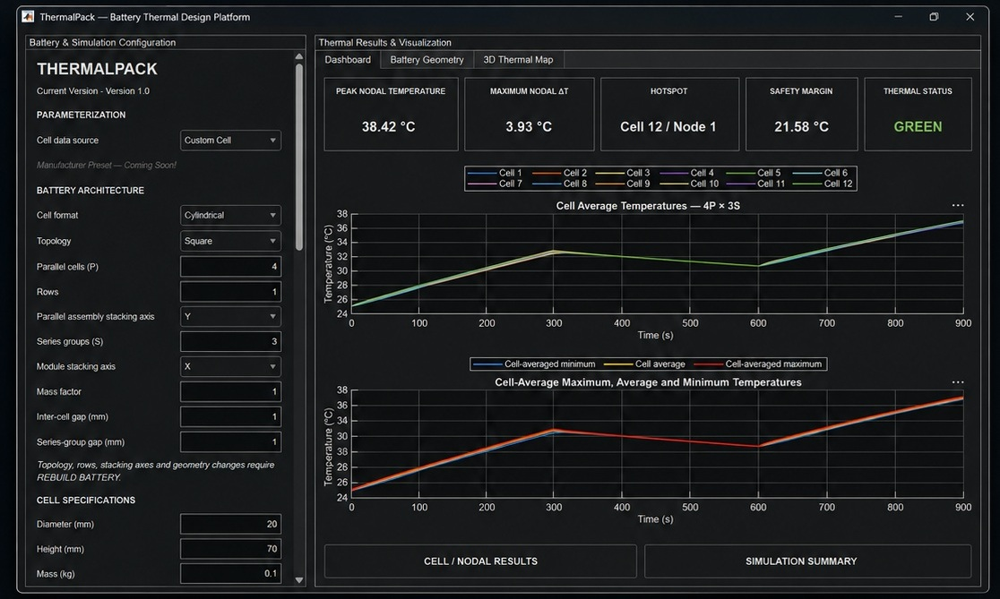
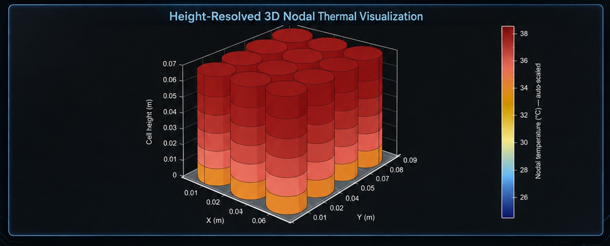

# ThermalPack

**Configurable Battery Electro-Thermal Modelling & Optimization - Version 2.0**

ThermalPack is a configurable, reduced-order battery electro-thermal modelling platform developed using **MATLAB, Simulink, Simscape Battery and Simscape Thermal Liquid**. It brings battery configuration, thermal analysis, 3D visualization, literature benchmarking and automated parameter sweeps into one engineering workflow.

The platform supports rapid investigation of temperature distributions, hotspots and cooling designs before more detailed analysis. Runtime savings relative to CFD depend on the model and study; no universal speedup is claimed.

## Version 2.0 capabilities

| Capability | What you can investigate |
| --- | --- |
| Battery configuration | Cylindrical, prismatic and pouch cells; series/parallel architecture; geometry; electrical and thermal properties |
| Electro-thermal models | Ohmic, 1RC and 2RC representations; configurable lookup tables; dynamic charge, rest and discharge profiles |
| Cooling architectures | Liquid top, bottom, top + bottom, side and serpentine cooling; forced-air cooling |
| Thermal KPIs | Peak nodal temperature, cell-average temperature histories, cell-to-cell and within-cell temperature differences, hotspots and temperature-limit margins |
| 3D visualization | Battery geometry and time-resolved, height-distributed nodal temperature maps |
| Cooling optimization | Automated flow/velocity and inlet-temperature sweeps; top/bottom flow-share sweeps where applicable |
| Design optimization | Architecture-specific geometry and thermal-resistance sweeps at a fixed operating point |
| Literature benchmarking | Forced-air comparison with Fan 2019 and bottom-cooling comparison with Bahiraei 2017 |
| Results and selection | Feasibility checks, adjustable recommendation priorities, all-case tables and plots, CSV/MAT exports |

## Quick start

1. Clone this repository or choose **Code → Download ZIP** and extract the complete folder.
2. Open the repository folder as the current folder in MATLAB.
3. Keep these items together, including every `+package` subfolder:

```text
ThermalPack_v2_App.m
Thermal_Model_v5.slx
Thermal_Pack_Libraries/
```

4. Launch the app:

```matlab
ThermalPack_v2_App
```

5. Configure the battery, cell data, load profile and cooling conditions; rebuild the battery, run the simulation and review the results. Use **Cooling Optimization**, **Design Optimization** or the literature-validation controls for comparative studies.

**Requirements:** MATLAB, Simulink, Simscape, Simscape Battery and Simscape Fluids. The supplied model was saved in **R2026a**, and the app uses R2026a Battery Equivalent Circuit settings. Use that release as the starting point; compatibility with other releases has not been verified.

The app creates `Thermal_Model_v5_UI.slx` from the master model at each launch. Rebuilt battery libraries are written to `ThermalPack_Generated/`. These generated working files are excluded from version control; the supplied `Thermal_Pack_Libraries/` folder is required and must remain available.

## Optimization workflow

Configure the main battery and cooling setup first. Each optimization window uses that setup and displays the applicable variables:

| Study | Swept variables |
| --- | --- |
| Liquid cooling operation | Total coolant mass flow and coolant inlet temperature; top-flow share for top + bottom cooling |
| Forced-air operation | Air inlet velocity and air inlet temperature |
| Top/bottom plate design | Plate thickness and cell-to-plate thermal resistance |
| Forced-air design | Inter-cell gap and cell-to-duct wall gap |
| Side-cooling design | Contact-height fraction and cell-to-side thermal resistance |
| Serpentine design | Contact-height fraction, circumference fraction and cell-to-serpentine thermal resistance |

**DESIGN LIMITS** sets the peak nodal-temperature and cell-to-cell temperature-difference constraints. **SELECTION CRITERIA** changes the recommendation order independently for cooling and design studies. The default order prioritizes peak nodal temperature, cell-to-cell difference, within-cell difference and then operating/design values, with lower values preferred. Operating recommendations are selected separately at each inlet temperature.

All sampled cases remain in the results, including failures and unrun cases. Star markers identify recommended feasible cases. Export the displayed table as CSV, or export the full sweep package with all-case and recommended-case CSV files plus MAT data. Pump/fan power and inlet-conditioning energy are not evaluated, so recommendations describe sampled thermal performance.

## Literature validation and benchmarking

Two comparison workflows are included:

- **Forced-Air Validation — Fan 2019:** aligned and staggered cylindrical arrangements, 2C, 20 °C inlet and 0.6–4 m/s air velocity.
- **Bottom-Cooling Validation — Bahiraei 2017:** the retained 6P × 1S prismatic paper-geometry case over 1400 s, including the 1 mm plate setup.

These are case-specific literature benchmarks. Reference curves include digitized paper data; the Bahiraei case uses estimated/surrogate electrical parameters with resistance scaling. Agreement in these cases does not establish predictive accuracy for every cell format or cooling architecture. Geometry, cell data and boundary conditions must be reviewed for each new study.

## Interface previews

These images show the earlier **Version 1.0** interface. Version 2.0 adds the configuration, optimization and benchmarking features described above.





## Versions and roadmap

| Version | Status | Scope |
| --- | --- | --- |
| 1.0 | Retained baseline | Cylindrical modules, bottom liquid cooling, thermal KPIs and 3D nodal visualization |
| 2.0 | Current version | Multiple cell formats and cooling architectures, configurable electro-thermal models, operating/design sweeps and literature benchmarking |
| 3.0 | Planned | Broader experimental/CFD validation, expanded pack-level analysis, advanced safety modelling and investigation of machine-learning-assisted acceleration |

Version 3.0 items are development goals. The existing temperature status and safety margin are threshold-based indicators; they do not predict thermal runaway.

## Repository contents

| Path | Purpose |
| --- | --- |
| `ThermalPack_v2_App.m` | Main application for battery configuration, simulation and optimization |
| `Thermal_Model_v5.slx` | Version 2.0 master physics model |
| `Thermal_Pack_Libraries/` | Required project-local Simscape sources and model libraries |
| `ThermalPackApp_v1_App.m`, `Thermal_Model_v3.slx` | Earlier Version 1.0 application and master model |
| `docs/VERSION_1.md` | Archived Version 1.0 documentation |

## Author

**Talha Ahmad** - Mechanical & Automotive Engineer  
M.Sc. Automotive Engineering, RWTH Aachen University

Battery Thermal Management · CFD · Reduced-Order Modelling · MATLAB/Simulink · Multiphysics Simulation
